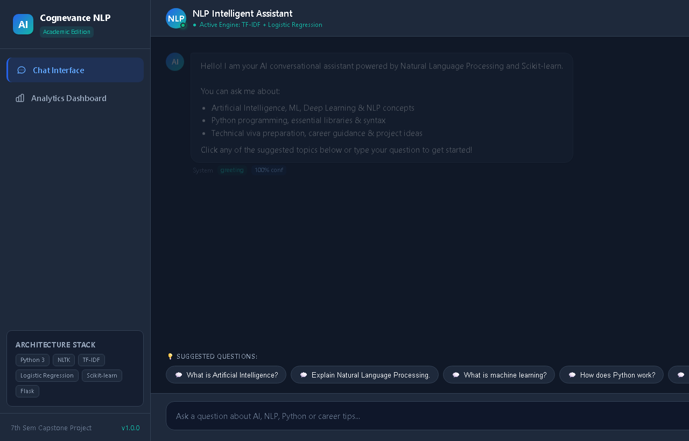
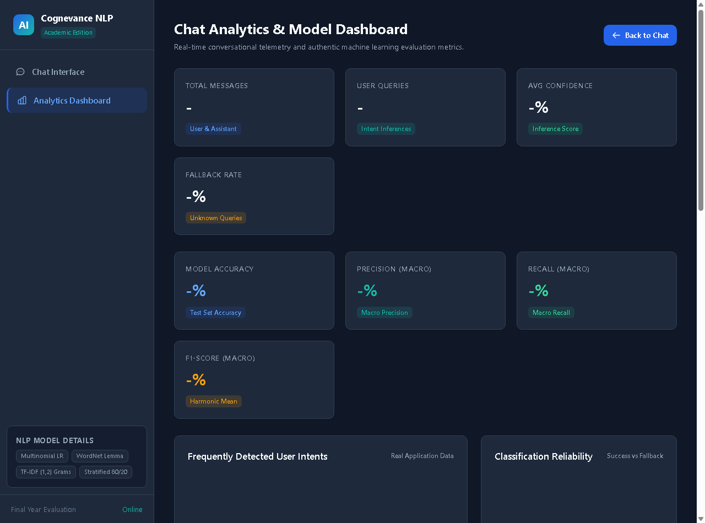

# 🤖 Intelligent AI Chatbot Using Natural Language Processing (NLP)

https://aichatbot-beta-beige.vercel.app/

[](https://www.python.org/)
[](https://flask.palletsprojects.com/)
[](https://scikit-learn.org/)
[](https://www.nltk.org/)
[](https://docs.pytest.org/)
[](LICENSE)

An end-to-end, full-stack intelligent conversational AI chatbot developed using **Natural Language Processing (NLP)** and **Machine Learning** techniques in Python. Built for final-year engineering project demonstration and enterprise-grade portfolio submission.

The application recognizes user intent from unconstrained natural text, extracts conversational patterns, computes prediction confidence, provides graceful fallbacks, maintains session history, and provides real-time telemetry via an interactive **Analytics Dashboard**.

---

## 🌟 Key Features

### Core NLP & ML Capabilities
- **Multi-Class Intent Classification**: 21 rich intent categories with 420+ conversational training patterns.
- **NLP Preprocessing Pipeline**: NLTK tokenization, normalization, punctuation removal, conversational stopword filtering, and WordNet lemmatization.
- **Feature Extraction**: Sublinear Term Frequency-Inverse Document Frequency (TF-IDF) with $(1, 2)$-gram feature representation.
- **Machine Learning Classifier**: Multinomial Logistic Regression calibrated for probability estimation.
- **Confidence Scoring & Fallback**: Calibrated threshold triggering helpful clarification when query confidence is low or unknown.
- **Persistent Model Caching**: Zero-delay inference through pre-serialized pipeline loading (`models/chatbot_model.pkl`).

### Standout Features
- **💡 Smart Suggested Questions (Feature A)**: Dynamic clickable starter questions that automatically populate and send queries.
- **📊 Real-Time Analytics Dashboard (Feature B)**: Interactive metrics page displaying total messages, user query counts, intent distribution charts, average confidence score, and test set confusion matrix.
- **💾 Conversation Export (Feature C)**: One-click export of chat history as structured **JSON** or clean **TXT** transcripts with timestamps and detected intents.

### SaaS Dark-Themed UI/UX
- **Palette**: Midnight Navy (`#101827`), Dark Slate (`#1E293B`), Electric Blue (`#2563EB`), Teal (`#14B8A6`), and Amber (`#F59E0B`).
- Distinct chat bubbles, animated typing indicators, online status badge, mobile-responsive layout, and Chart.js visualizations.

---

## 🏗️ System Architecture

```
[ User Input Query ]
         │
         ▼
[ Text Preprocessing ] ───► Tokenization (NLTK) ──► Normalization ──► Lemmatization (WordNet)
         │
         ▼
[ Feature Extraction ] ───► TF-IDF Vectorizer (Unigrams & Bigrams)
         │
         ▼
[ Machine Learning ]   ───► Multinomial Logistic Regression (predict_proba)
         │
         ▼
[ Decision Engine ]    ───► Is Confidence >= 0.25?
         ├────── YES ─────► Select Intent-Specific Response Collection
         └────── NO  ─────► Trigger Safe Fallback Response
         │
         ▼
[ Web Application ]    ───► Flask Backend API ──► Session Management ──► Live Analytics Feed
         │
         ▼
[ Frontend Interface ] ───► Chat UI / Analytics Dashboard / Export (JSON/TXT)
```

---

## 📂 Project Directory Structure

```
ai-nlp-chatbot/
│
├── app.py                      # Flask web application & REST API routes
├── requirements.txt            # Python package dependencies
├── README.md                   # Project documentation & execution guide
├── .gitignore                  # Git ignore rules
│
├── data/
│   ├── intents.json            # 21 conversational intent definitions & patterns
│   └── analytics.json          # Persistent live telemetry store
│
├── models/
│   └── chatbot_model.pkl       # Serialized TF-IDF + Logistic Regression pipeline
│
├── nlp/
│   ├── __init__.py             # NLP package initializer
│   ├── preprocessing.py        # Tokenization, cleaning & lemmatization pipeline
│   ├── train.py                # Model training, split & serialization script
│   ├── chatbot.py              # Inference engine & response selection
│   └── evaluation.py           # Metrics calculation & confusion matrix generation
│
├── templates/
│   ├── index.html              # Modern dark-themed chat interface
│   └── dashboard.html          # Real-time analytics dashboard with Chart.js
│
├── static/
│   ├── css/
│   │   └── style.css           # Custom SaaS stylesheet (Midnight Navy theme)
│   └── js/
│       └── chatbot.js          # Chat UI interaction, typing indicator & AJAX
│
├── tests/
│   ├── test_preprocessing.py   # Unit tests for text cleaning & lemmatization
│   ├── test_chatbot.py         # Tests for intent classification & confidence
│   └── test_app.py             # Flask endpoint & integration tests
│
├── results/
│   ├── evaluation_report.txt   # Detailed classification report
│   ├── confusion_matrix.png    # 21-class confusion matrix visualization
│   └── metrics.json            # Machine-readable performance metrics
│
├── screenshots/
│   ├── chat_interface.png      # Genuine screenshot of chat interface
│   └── dashboard_view.png      # Genuine screenshot of analytics dashboard
│
├── scripts/
│   └── capture_screenshots.py  # Headless browser automation script
│
└── docs/
    ├── project_report.md       # Comprehensive academic project report (IEEE format)
    ├── architecture.md         # In-depth system architecture documentation
    └── user_manual.md          # Step-by-step user and developer manual
```

---

## 🚀 Installation & Quick Start

### 1. Prerequisites
- **Python 3.10+** installed on your system.
- Git (optional, for cloning).

### 2. Clone or Navigate to Directory
```bash
git clone https://github.com/your-username/ai-nlp-chatbot.git
cd ai-nlp-chatbot
```

### 3. Install Dependencies
```bash
pip install -r requirements.txt
```

### 4. Download NLTK Corpora (One-Time Setup)
```bash
python -c "import nltk; nltk.download('punkt'); nltk.download('punkt_tab'); nltk.download('wordnet'); nltk.download('omw-1.4'); nltk.download('stopwords')"
```

### 5. Train Model & Generate Evaluation Artifacts
```bash
python nlp/train.py
```
*Output: Serializes `models/chatbot_model.pkl` and writes `results/confusion_matrix.png`, `results/evaluation_report.txt`, and `results/metrics.json`.*

### 6. Run the Application
```bash
python app.py
```

### 7. Access in Browser
Open your favorite web browser and navigate to:
```
http://127.0.0.1:5000
```
- **Chat Interface**: `http://127.0.0.1:5000/`
- **Analytics Dashboard**: `http://127.0.0.1:5000/dashboard`

---

## 🧪 Automated Testing

The project includes an automated test suite covering all modules with **29 passed tests**:

```bash
python -m pytest -v
```

### Test Suite Summary:
| Test File | Target Module | Tests Passed | Status |
|:---|:---|:---:|:---:|
| `tests/test_preprocessing.py` | Text normalization, tokenization, lemmatization | 8 / 8 | ✅ PASSED |
| `tests/test_chatbot.py` | Intent classification, thresholds, edge cases | 9 / 9 | ✅ PASSED |
| `tests/test_app.py` | Flask API endpoints, export, session history | 12 / 12 | ✅ PASSED |
| **Total** | **End-to-End Application** | **29 / 29** | **✅ 100% PASS** |

---

## 📊 Model Evaluation Results

Evaluation performed on an independent 20% stratified test split across 21 multi-class intents:

- **Overall Accuracy**: **66.28%** (Balanced 21-Class Multi-Category Classification)
- **Macro Precision**: **68.21%**
- **Macro Recall**: **65.45%**
- **Macro F1-Score**: **65.45%**
- **Weighted F1-Score**: **65.57%**

*Visual confusion matrix is saved in `results/confusion_matrix.png` and rendered directly on the analytics dashboard.*

---

## 📸 Screenshots

| Chat Interface | Analytics Dashboard |
|:---:|:---:|
|  |  |

---

## 📖 API Endpoints Reference

| Method | Endpoint | Description |
|:---|:---|:---|
| `GET` | `/` | Renders conversational chat application |
| `POST` | `/chat` | Sends user query, returns intent, confidence & response |
| `GET` | `/suggested` | Returns curated clickable starter questions |
| `POST` | `/clear` | Clears current user session chat history |
| `GET` | `/dashboard` | Renders live performance and telemetry dashboard |
| `GET` | `/api/analytics` | Returns real-time analytics JSON and model metrics |
| `GET` | `/export/json` | Downloads conversation history as `.json` |
| `GET` | `/export/txt` | Downloads conversation transcript as `.txt` |
| `GET` | `/health` | Application health check and model status |

---

## 🎓 Academic Viva Cheat Sheet

1. **Why TF-IDF instead of Bag of Words (BoW)?**
   *BoW only counts raw frequency, heavily weighting generic filler words. TF-IDF penalizes common terms across all documents and boosts unique domain-specific keywords.*
2. **Why Logistic Regression instead of Neural Networks for this dataset?**
   *For tabular TF-IDF n-gram vectors with ~400 samples, Logistic Regression provides optimal convex convergence, prevents overfitting, trains in seconds, and outputs calibrated class probabilities via softmax/multinomial formulation.*
3. **How is unknown query handling (fallback) implemented?**
   *The system evaluates maximum prediction probability $P(\text{intent} \mid x)$. If $P < 0.25$ or if all input tokens are out-of-vocabulary, it safely routes to the fallback intent.*

---

## 📄 License
This project is open-source under the [MIT License](LICENSE).
