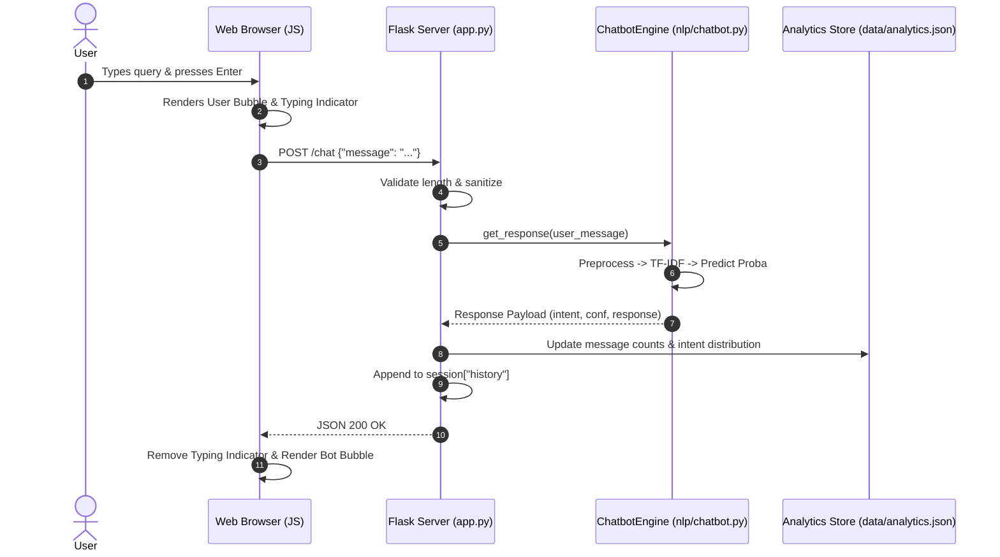

# SYSTEM ARCHITECTURE SPECIFICATION
## AI Chatbot Using Natural Language Processing (NLP)

This document provides a comprehensive technical breakdown of the system architecture, component contracts, data flows, and design decisions for the AI Chatbot project.

---

## 1. High-Level Architecture Overview

The system is architected as a lightweight, modular **Client-Server MVC / Pipeline Architecture**:

```mermaid
graph TD
    User["User Client (Web Browser)"] <-->|HTTP / REST (JSON)| FlaskApp["Flask Backend Service (app.py)"]
    
    subgraph Web_Tier [Presentation & Web Tier]
        FlaskApp <--> IndexView["Chat View (index.html)"]
        FlaskApp <--> DashView["Dashboard View (dashboard.html)"]
        FlaskApp <--> SessionStore["Flask Cookie Session"]
    end
    
    subgraph Storage_Tier [Data & Persistence Tier]
        AnalyticsDB[("data/analytics.json")] <-->|Thread-Safe Read/Write| FlaskApp
        ModelArtifact[("models/chatbot_model.pkl")] -->|Single-Load Caching| ChatEngine
        IntentsDataset[("data/intents.json")] -->|Training Pipeline| TrainModule["nlp/train.py"]
    end

    subgraph NLP_Pipeline [NLP & ML Inference Tier]
        FlaskApp <--> ChatEngine["Chatbot Engine (nlp/chatbot.py)"]
        ChatEngine --> Preprocessor["Text Preprocessor (nlp/preprocessing.py)"]
        ChatEngine --> Vectorizer["TF-IDF Vectorizer (1,2 Grams)"]
        ChatEngine --> Classifier["Logistic Regression (Multinomial)"]
        ChatEngine --> ResponsePicker["Intent Response Collection"]
    end
```

---

## 2. Component Decomposition

### 2.1 Text Preprocessor (`nlp/preprocessing.py`)
- **Responsibilities**: Normalization, cleansing, tokenization, stopword management, and lemmatization.
- **Key Classes / Functions**:
  - `TextPreprocessor`: Object-oriented preprocessor with configurable lemmatizer and stopword rules.
  - `clean_text(text: str) -> str`: Normalizes lowercase, strips URLs, emails, and punctuation.
  - `tokenize(text: str) -> List[str]`: Splits words using NLTK `word_tokenize` with a regex fallback.
  - `lemmatize_token(token: str) -> str`: Multi-pass noun and verb lemmatizer using WordNet.
  - `process_tokens(tokens: List[str]) -> List[str]`: Filters non-essential stopwords while strictly retaining conversational interrogatives (`what`, `how`, `who`, `why`, `where`, `can`, `is`).

### 2.2 Model Training & Serialization (`nlp/train.py`)
- **Responsibilities**: Training data ingestion, stratified train/test partitioning, pipeline construction, hyperparameter tuning, model persistence, and evaluation execution.
- **Pipeline Specification**:
  ```python
  Pipeline([
      ('tfidf', TfidfVectorizer(
          ngram_range=(1, 2),
          min_df=1,
          sublinear_tf=True,
          strip_accents='unicode'
      )),
      ('classifier', LogisticRegression(
          C=12.0,
          max_iter=1000,
          solver='lbfgs',
          random_state=42
      ))
  ])
  ```
- **Serialization Artifact (`models/chatbot_model.pkl`)**:
  - `pipeline`: Fitted Scikit-learn Pipeline object.
  - `intents_data`: Parsed JSON intents dictionary for response mapping.
  - `classes`: Ordered array of intent labels.

### 2.3 Inference Engine (`nlp/chatbot.py`)
- **Responsibilities**: Thread-safe model caching, intent probability computation, confidence gate evaluation, and response retrieval.
- **Singleton Pattern**: The `ChatbotEngine` is initialized once via `get_chatbot_instance()`, avoiding redundant disk I/O and deserialization overhead on each user HTTP request.
- **Confidence Gate Rule**:
  ```python
  if confidence < 0.25:
      return {
          "intent": "fallback",
          "confidence": confidence,
          "is_fallback": True
      }
  ```

### 2.4 Web Application Controller (`app.py`)
- **Responsibilities**: REST endpoint routing, request validation, cookie-based session management, real-time analytics aggregation, and file export formatting.
- **Concurrency & Thread Safety**: Runtime telemetry updates to `data/analytics.json` are synchronized using `threading.Lock()` to prevent race conditions during concurrent user requests.

---

## 3. Data Flow Diagram



---

## 4. API Data Contract Specifications

### 4.1 Chat Request & Response
- **Endpoint**: `POST /chat`
- **Request Headers**: `Content-Type: application/json`
- **Request Body**:
  ```json
  {
      "message": "What is Natural Language Processing?"
  }
  ```
- **Response Body (Success 200)**:
  ```json
  {
      "response": "Natural Language Processing (NLP) is an interdisciplinary field...",
      "intent": "natural_language_processing",
      "confidence": 0.8924,
      "is_fallback": false,
      "timestamp": "02:15 PM"
  }
  ```

### 4.2 Analytics Telemetry
- **Endpoint**: `GET /api/analytics`
- **Response Body (200)**:
  ```json
  {
      "total_messages": 12,
      "total_queries": 6,
      "fallback_count": 0,
      "fallback_rate": 0.0,
      "avg_confidence": 0.7421,
      "top_intents": [
          { "intent": "natural_language_processing", "count": 2 },
          { "intent": "machine_learning", "count": 1 }
      ],
      "model_metrics": {
          "accuracy": 0.6628,
          "f1_macro": 0.6545,
          "precision_macro": 0.6821,
          "recall_macro": 0.6545
      }
  }
  ```

---

## 5. Security & Input Validation Controls

1. **Input Truncation**: User messages are capped at 1,000 characters to prevent buffer bloat and denial-of-service attempts.
2. **XSS Prevention**: Frontend JavaScript employs an HTML entity escaping helper (`escapeHtml()`) before injecting strings into the DOM.
3. **Session Integrity**: Flask sessions are signed using cryptographically generated keys (`FLASK_SECRET_KEY`).
4. **Offline Isolation**: All model weights, vectorizer parameters, and evaluation charts run 100% locally with zero external network transmission.
