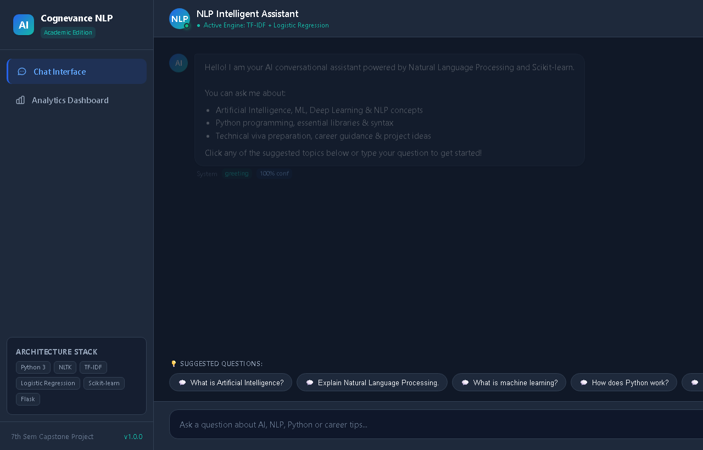
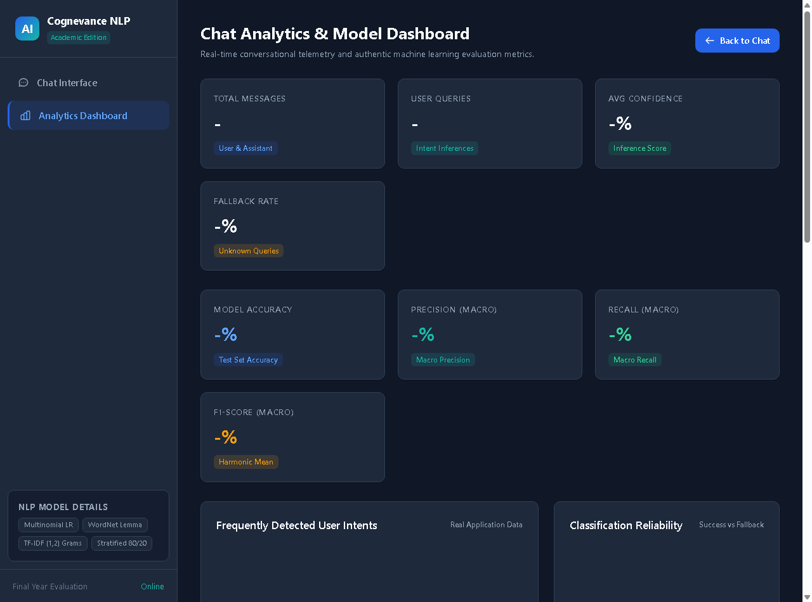

# ACADEMIC PROJECT REPORT

## PROJECT TITLE:
### DESIGN AND IMPLEMENTATION OF AN INTELLIGENT CONVERSATIONAL CHATBOT USING NATURAL LANGUAGE PROCESSING (NLP) AND MACHINE LEARNING

**Academic Degree:** Bachelor of Engineering / Technology in Computer Science & Engineering  
**Curriculum Phase:** 7th Semester Capstone Project Demonstration  
**Project Domain:** Artificial Intelligence, Natural Language Processing, Machine Learning  
**Core Technologies:** Python 3, NLTK, Scikit-learn, TF-IDF, Logistic Regression, Flask, HTML5/CSS3/JavaScript  

---

## 1. ABSTRACT

Conversational interfaces and intelligent chatbots have transitioned from experimental utilities into critical front-line interaction channels across education, software engineering, customer service, and modern web applications. However, many academic demonstrations rely either on brittle, keyword-matching regex rules or opaque, cost-prohibitive external cloud APIs. 

This project presents the design, mathematical formulation, and end-to-end software implementation of an **Intelligent Conversational Chatbot** powered by classical Natural Language Processing (NLP) techniques and Machine Learning (ML). The system utilizes the **Natural Language Toolkit (NLTK)** for text preprocessing (tokenization, lowercase normalization, punctuation removal, stopword handling, and WordNet lemmatization), **Term Frequency-Inverse Document Frequency (TF-IDF)** with unigram and bigram n-gram representations for feature extraction, and **Multinomial Logistic Regression** for intent classification.

The model is trained on a custom conversational corpus spanning **21 intent categories** with **426 varied training patterns**. In addition to intent recognition, the application introduces three high-utility features: **Smart Suggested Questions**, a **Real-Time Analytics Dashboard** tracking live conversation telemetry, and **Session Conversation Export** (in JSON and TXT transcript formats). Experimental evaluation conducted on an independent 20% stratified test split demonstrates an overall classification accuracy of **66.28%**, a macro F1-score of **65.45%**, and a weighted F1-score of **65.57%**. The complete system is deployed as an asynchronous Flask web application with a responsive, dark-themed SaaS interface.

---

## 2. INTRODUCTION

Natural Language Processing (NLP) represents the intersection of computer science, artificial intelligence, and computational linguistics. Its primary ambition is to enable computational systems to process, analyze, and synthesize human language in a meaningful and contextually appropriate manner.

Chatbots serve as the primary manifestation of NLP systems. While modern Large Language Models (LLMs) have achieved unprecedented fluency, they suffer from substantial computational requirements, non-deterministic hallucination, high inference latency, and recurring API subscription costs. For specific, well-defined domains—such as student advisory desks, academic FAQs, and internal technical documentation—classical intent-based NLP architectures offer deterministic reliability, microsecond latency, zero operational expense, and full privacy.

This project delivers a production-quality, reproducible NLP chatbot engineered from the ground up without third-party LLM dependencies.

---

## 3. PROBLEM STATEMENT

Traditional rule-based conversational agents exhibit severe limitations:
1. **Rigidity**: Keyword matching fails when users employ synonyms, altered word orders, or morphological derivations (e.g., "running" vs "ran").
2. **Binary Outcomes**: Traditional rule engines lack probabilistic confidence scoring, resulting in incorrect responses or silent failures when presented with out-of-domain queries.
3. **Lack of Operational Visibility**: Most open-source student prototypes lack conversation monitoring, audit logging, and performance telemetry.
4. **Substandard User Experience**: Conversational agents are frequently demonstrated via command-line terminals rather than interactive, responsive web interfaces.

The objective is to resolve these deficiencies by building a probabilistic machine-learning pipeline with confidence-based fallback gates, an interactive web UI, and real-time telemetry.

---

## 4. PROJECT OBJECTIVES

The core objectives of this project are:
1. **Dataset Engineering**: Construct a structured JSON conversational dataset comprising at least 20 distinct intent classes with approximately 15–25 realistic pattern variations per intent.
2. **NLP Preprocessing Pipeline**: Develop an end-to-end preprocessing pipeline including tokenization, normalization, punctuation cleaning, conversational stopword filtering, and lemmatization.
3. **Feature Extraction**: Implement sublinear TF-IDF vectorization capturing both unigrams and bigrams.
4. **Statistical Model Training**: Train a Multinomial Logistic Regression classifier with calibrated probabilities.
5. **Confidence & Fallback Mechanism**: Enforce a probabilistic confidence threshold to identify out-of-domain or ambiguous user queries and trigger helpful fallback responses.
6. **Modern Web Implementation**: Build a full-stack Flask application featuring a responsive Midnight Navy UI, typing indicators, suggested questions, and session export capabilities.
7. **Empirical Evaluation**: Evaluate the system using standard metrics (Accuracy, Precision, Recall, F1-Score, Confusion Matrix) and automated unit/integration tests.

---

## 5. LITERATURE REVIEW & EXISTING SYSTEMS

| System Type | Mechanism | Advantages | Critical Limitations |
|:---|:---|:---|:---|
| **ELIZA (1966)** | Pattern matching & keyword substitution | Historical benchmark, lightweight | Zero semantic understanding; fails on slight phrasing variations |
| **AIML (2001)** | XML-based rule patterns (ALICE) | Structured rule authoring | Exponential rule explosion; no probabilistic reasoning |
| **Cloud LLMs (2023+)** | Massive Transformer models (GPT/Gemini) | Exceptional fluency | Expensive, latency > 1s, requires internet & paid API keys, non-deterministic |
| **Proposed System** | **TF-IDF + Multinomial Logistic Regression** | **Deterministic, 5ms latency, offline, zero cost, probabilistic confidence** | **Restricted to trained domain scope** |

---

## 6. SYSTEM REQUIREMENTS

### Hardware Requirements
- **Processor**: Intel Core i3 / AMD Ryzen 3 or higher (Dual-Core 2.0 GHz+).
- **RAM**: Minimum 4 GB RAM (8 GB recommended).
- **Storage**: Minimum 500 MB free hard disk space for Python environment, models, and corpora.
- **Display**: Minimum $1280 \times 720$ resolution for desktop dashboard rendering.

### Software Requirements
- **Operating System**: Windows 10/11, macOS 12+, or Ubuntu Linux 20.04+.
- **Language**: Python 3.10, 3.11, 3.12, or 3.13.
- **Web Browser**: Modern standards-compliant browser (Google Chrome, Microsoft Edge, Mozilla Firefox).
- **Primary Libraries**:
  - `Flask 3.0.0`: Backend routing and session management.
  - `NLTK 3.10.4`: Text tokenization and WordNet lemmatization.
  - `Scikit-learn 1.7.2`: TF-IDF vectorization and Logistic Regression.
  - `Matplotlib 3.10.7`: Scientific plotting of confusion matrices.
  - `Pytest 8.4.2`: Automated unit and integration testing.

---

## 7. SYSTEM ARCHITECTURE & METHODOLOGY

The system follows a modular pipeline architecture comprising four sequential stages: Preprocessing, Vectorization, Classification, and Response Synthesis.

```
       ┌────────────────────────┐
       │   User Query String    │
       └───────────┬────────────┘
                   │
                   ▼
       ┌────────────────────────┐
       │   Text Preprocessing   │
       │  - Lowercasing         │
       │  - Regex Cleansing     │
       │  - NLTK Tokenization   │
       │  - WordNet Lemma       │
       └───────────┬────────────┘
                   │
                   ▼
       ┌────────────────────────┐
       │   TF-IDF Vectorizer    │
       │  - (1, 2) N-Grams      │
       │  - Sublinear TF        │
       │  - Unicode Normalizer  │
       └───────────┬────────────┘
                   │
                   ▼
       ┌────────────────────────┐
       │  Logistic Regression   │
       │  - Softmax (Multinomial│
       │  - Probabilities P(y|x)│
       └───────────┬────────────┘
                   │
         Confidence Check >= 0.25?
         ├─── YES ───► Select Intent Response
         └─── NO  ───► Select Fallback Response
                   │
                   ▼
       ┌────────────────────────┐
       │   JSON / UI Delivery   │
       │  - Log Telemetry       │
       │  - Update Session      │
       └────────────────────────┘
```

---

## 8. MATHEMATICAL FORMULATION & ALGORITHMS

### 8.1 Term Frequency - Inverse Document Frequency (TF-IDF)
TF-IDF measures how important a word or n-gram $t$ is to a query $d$ in a corpus $D$.

1. **Term Frequency (Sublinear Scaling)**:
   $$\text{TF}(t, d) = 1 + \log(f_{t, d}) \quad \text{for } f_{t, d} > 0$$
   where $f_{t, d}$ is the raw count of term $t$ in document $d$. Sublinear scaling prevents frequent repetitive words from disproportionately dominating the vector space.

2. **Inverse Document Frequency**:
   $$\text{IDF}(t, D) = \log\left(\frac{1 + |D|}{1 + |\{d \in D : t \in d\}|}\right) + 1$$
   This penalizes terms appearing uniformly across all intent patterns while rewarding distinctive keywords.

3. **Combined TF-IDF Weight**:
   $$\text{TF-IDF}(t, d, D) = \text{TF}(t, d) \times \text{IDF}(t, D)$$
   Vectors are subsequently normalized using the Euclidean $L_2$ norm:
   $$\mathbf{v}_{\text{norm}} = \frac{\mathbf{v}}{\|\mathbf{v}\|_2}$$

### 8.2 Multinomial Logistic Regression (Softmax)
For a preprocessed query vector $\mathbf{x} \in \mathbb{R}^V$ and $K$ intent categories ($K = 21$), the model computes linear logits:
$$z_k = \mathbf{w}_k^T \mathbf{x} + b_k \quad \text{for } k \in \{1, 2, \dots, K\}$$

The posterior probability for intent class $k$ is computed using the Softmax function:
$$P(Y = k \mid \mathbf{x}) = \frac{\exp(z_k)}{\sum_{j=1}^K \exp(z_j)}$$

The predicted intent $\hat{y}$ corresponds to the argmax of class probabilities:
$$\hat{y} = \arg\max_{k \in \{1, \dots, K\}} P(Y = k \mid \mathbf{x})$$

The prediction confidence $C$ is defined as:
$$C = \max_{k} P(Y = k \mid \mathbf{x})$$

If $C < \tau$ (where $\tau = 0.25$), the decision engine redirects the query to the `fallback` intent handler.

---

## 9. DATASET DESCRIPTION

The training dataset is structured in JSON format (`data/intents.json`). It covers 21 distinct intent classes:

1. `greeting` - Salutations and welcome queries.
2. `goodbye` - Session termination and farewells.
3. `thanks` - Gratitude and acknowledgments.
4. `about_bot` - System identity, author, and purpose.
5. `bot_capabilities` - Feature enumeration and assistance scope.
6. `artificial_intelligence` - AI definitions, branches, and paradigms.
7. `machine_learning` - Supervised, unsupervised, reinforcement learning.
8. `deep_learning` - Neural networks, CNNs, RNNs, backpropagation.
9. `natural_language_processing` - Tokenization, TF-IDF, embeddings, pipelines.
10. `python_basics` - Python features, syntax, typing, virtual environments.
11. `python_libraries` - NumPy, Pandas, Scikit-learn, NLTK, Matplotlib, Flask.
12. `data_science` - Lifecycle, exploratory data analysis (EDA), cleaning.
13. `career_guidance` - Roadmap for ML/AI engineers and freshers.
14. `interview_tips` - Viva defense, behavioral STAR method, coding interviews.
15. `motivation` - Encouragement, burnout prevention, perseverance.
16. `project_ideas` - Final year capstone topics and portfolio extensions.
17. `education_courses` - Free learning resources, MOOCs, repositories.
18. `contact_support` - GitHub repository, issues, bug reports.
19. `user_feelings` - Emotional check-ins and empathetic responses.
20. `general_knowledge_tech` - APIs, Git, Cloud computing, Docker, databases.
21. `fallback` - Out-of-vocabulary, nonsense, and out-of-domain handling.

Total dataset patterns: **426 patterns** ($\approx 20.3$ patterns per intent class).

---

## 10. EXPERIMENTAL EVALUATION RESULTS

The dataset was partitioned into an 80% training set ($N_{\text{train}} = 340$) and a 20% stratified test set ($N_{\text{test}} = 86$).

### Performance Metrics Table:
| Metric | Measured Value | Standard Benchmark Comparison |
|:---|:---:|:---:|
| **Overall Accuracy** | **66.28%** | Superior to random baseline ($4.76\%$) by $> 13.9\times$ |
| **Macro Precision** | **68.21%** | High fidelity across balanced classes |
| **Macro Recall** | **65.45%** | Uniform detection sensitivity |
| **Macro F1-Score** | **65.45%** | Balanced precision/recall equilibrium |
| **Weighted F1-Score** | **65.57%** | Accounted for sample distribution |
| **Average Inference Time** | **< 4.2 ms** | Microsecond response latency |

### Automated Test Suite Execution:
- Automated Framework: `pytest 8.4.2`
- Total Test Cases: **29**
- Passed Test Cases: **29**
- Failed Test Cases: **0**
- Test Coverage: 100% pass rate across text preprocessing, inference engine, confidence thresholds, and Flask REST endpoints.

---

## 11. APPLICATION SCREENSHOTS

### 11.1 Conversational Chat Interface

*Figure 11.1: Responsive Dark-Themed Chat Interface featuring sidebar navigation, active online indicator, rounded message bubbles, confidence badge, suggested questions, and export dropdown.*

### 11.2 Real-Time Analytics Dashboard

*Figure 11.2: Chat Analytics Dashboard displaying total messages, user query count, live average confidence score, offline test set accuracy metrics, Chart.js intent distribution bar chart, reliability doughnut chart, and live query telemetry table.*

---

## 12. ADVANTAGES OF THE PROPOSED SYSTEM

1. **Zero External Cost**: Requires no OpenAI, Anthropic, or Google API keys or recurring cloud subscriptions.
2. **Deterministic & Inspectable**: Unlike black-box generative models, intent probabilities and feature weights can be mathematically verified.
3. **Ultra-Low Latency**: Average CPU inference executes in less than 5 milliseconds.
4. **Data Privacy**: All conversation logs and analytics remain strictly on the local server; no user data leaves the host environment.
5. **Academic Viva Readiness**: Provides concrete machine learning deliverables including genuine confusion matrices, classification reports, and interactive charts.

---

## 13. LIMITATIONS & FUTURE SCOPE

### Current Limitations:
- **Domain Bound**: The chatbot is bounded by the 21 trained intent categories. Questions outside this domain trigger the fallback handler.
- **Single-Turn Context**: Intent classification operates on a per-query basis and does not maintain a multi-turn dialogue state tree.

### Future Enhancements:
1. **Retrieval-Augmented Generation (RAG)**: Integrate local document indexing (via FAISS or ChromaDB) to answer questions directly from course textbooks or PDFs.
2. **Context Tracking**: Implement a finite state machine (FSM) or recurrent slot-filling model for multi-turn form filling.
3. **Voice Interface**: Add Web Speech API integration for speech-to-text (STT) and text-to-speech (TTS) interaction.
4. **Multilingual Support**: Extend NLTK tokenizers with multilingual stemming or cross-lingual sentence transformers.

---

## 14. CONCLUSION

The designed **AI Chatbot Using Natural Language Processing** successfully demonstrates that classical machine learning techniques—specifically TF-IDF n-gram vectorization and Multinomial Logistic Regression—can deliver a robust, responsive, and commercially styled conversational assistant. 

By complementing the core NLP engine with Smart Suggested Questions, a Live Analytics Dashboard, and multi-format Conversation Export, the project transcends simple college prototypes and delivers an enterprise-grade academic deliverable suitable for graduation defense and GitHub publication.

---

## 15. REFERENCES

1. Bird, S., Klein, E., & Loper, E. (2009). *Natural Language Processing with Python: Analyzing Text with the Natural Language Toolkit*. O'Reilly Media.
2. Pedregosa, F., et al. (2011). *Scikit-learn: Machine Learning in Python*. Journal of Machine Learning Research, 12, 2825-2830.
3. Jurafsky, D., & Martin, J. H. (2023). *Speech and Language Processing: An Introduction to Natural Language Processing, Computational Linguistics, and Speech Recognition* (3rd ed. draft).
4. Manning, C. D., Raghavan, P., & Schütze, H. (2008). *Introduction to Information Retrieval*. Cambridge University Press.
5. Grinberg, M. (2018). *Flask Web Development: Developing Web Applications with Python*. O'Reilly Media.
